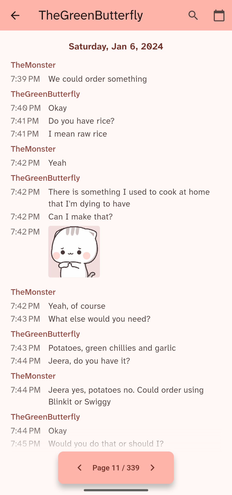
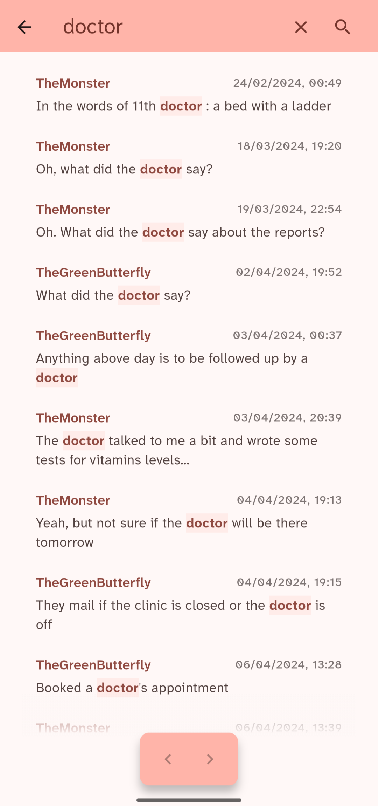

# Phire

Phire is a conversation reader that reimagines your chat history into a book-like structured reading experience.

**Phire** (pronounced _fee-ray_) takes its name from the Bengali word **ফিরে**, meaning _back_ or _returning_.

## Screenshots

|                   Conversations                   |                       Reader                        |                       Search                        |
| :-----------------------------------------------: | :-------------------------------------------------: | :-------------------------------------------------: |
|  |  |  |

## Features

- Import WhatsApp chat with or without media
- Navigate conversations by pages and dates
- Resume reading where you left off
- Search messages in a conversation and jump to selected message
- View animated stickers and open other media/attachments externally

## Roadmap

- [x] Navigate to specific dates
- [x] WhatsApp ZIP archive import
- [x] Show stickers and handle other attachments
- [x] Track and restore reading position
- [x] Search through messages
- [ ] Bookmarks
- [ ] Annotations

## License

This project is licensed under the GNU General Public License v3.0 or later.

See [LICENSE](LICENSE) for details.
